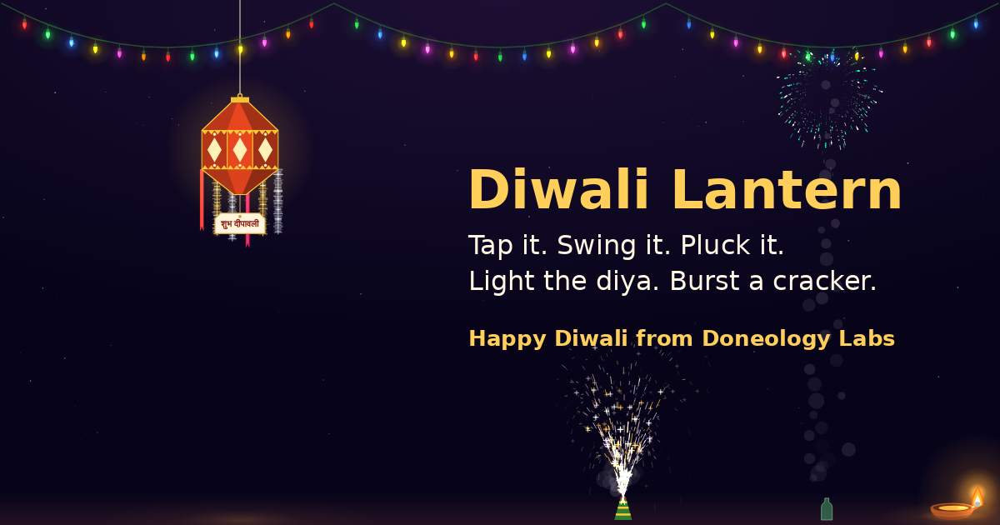

# Diwali Lantern 🪔

An interactive Diwali scene: a glowing 3D **kandil**, a **laddi / jhalar** of string lights, a 3D **clay diya** and **crackers** — with real physics. Tap it, swing it, pluck it, light it up.

**▶ Play it now (no install, works on Android, iPhone, Windows, Mac, Linux):**
**https://arunkw.github.io/diwali-lantern/**



Happy Diwali from [Doneology Labs](https://arunkw6.wixsite.com/doneology-labs).

---

## What you can do

| Action | What happens |
|---|---|
| Click / tap the kandil | Its light switches off; click again to switch it on |
| Drag the kandil | It swings like a pendulum on its cord when you let go |
| Pull the kandil straight down hard, or click its cord | It is plucked and falls to the floor (on Windows, onto the taskbar) |
| Brush the kandil with the pointer | It slowly turns on its cord, showing its other sides |
| Drag the corner handle of the kandil or diya | Resizes it diagonally (tap it first on a phone); the size is remembered |
| Brush the string lights | The wire and bulbs swing |
| Click a bulb | That bulb switches off / on |
| Click the diya | The flame goes out, the wick glows and a thread of soot smoke curls up; click again to relight |
| Drag the diya | It slides left or right; the forward-facing flame flickers with the motion |
| Click anywhere | A sparkle burst at that spot |
| Double-click / double-tap | A random cracker drops to the floor — anar (flower pot), bomb, ladi or rocket — and the pointer becomes a phuljhadi (sparkler) |
| ⚙ Options (top-right) | 3 kandils (Akash Kandil of translucent colour paper, thermacol Star Kandil, Paper Globe), 3 light styles, 3 diyas (classic terracotta, painted, lotus), re-hang, reset sizes, sounds |

## Three ways to run it

### 1. Web link (recommended for sharing)
Open **https://arunkw.github.io/diwali-lantern/**. Nothing to install, nothing to trust. On Android (Chrome) and iPhone (Safari) you can use **Add to Home screen** and it opens full-screen like an app, even offline.

### 2. Windows desktop overlay
The Windows app floats **over your other apps**, just like Dussehra Garland: string lights along the top of the screen, the kandil hanging below them, and the diya sitting on the taskbar. You keep working normally underneath.

Download `DiwaliLantern-x.y.z.exe` from [**Releases**](https://github.com/arunkw/diwali-lantern/releases/latest) and run it. No installation.

How the overlay behaves:
- Clicks pass straight through to the app underneath, except on the kandil, the diya, the bulbs and the resize handles.
- It never takes keyboard focus and installs **no keyboard or mouse hooks and no global shortcuts**, so typing, Alt+Tab, Ctrl+Shift+Esc and every other shortcut work as normal. It stays on top the ordinary way, so Task Manager and any window you bring forward still come to the front.
- Brush the lights or the kandil with your pointer and they sway; click the kandil, a bulb or the diya to switch it; drag the kandil to swing it, pull it hard to pluck it; drag the diya; drag a corner handle to resize.
- A click in any app leaves a sparkle there, and a double-click drops a cracker on the taskbar (turn this off in the menu).
- **Options and Quit:** right-click the kandil or diya, or right-click the tray icon near the clock. Double-click the tray icon to hide or show.

> **Windows SmartScreen** will say *"Windows protected your PC"* because the exe is not code-signed (a paid certificate). Click **More info → Run anyway**. If you prefer not to, use the web link — it is the same scene, in a browser tab.

### 3. Run from source
```bash
git clone https://github.com/arunkw/diwali-lantern.git
cd diwali-lantern/desktop
pip install -r requirements.txt
python diwali_lantern.py      # Windows overlay (Python 3.10+)
build_exe.bat                 # build DiwaliLantern.exe yourself
```
The web version is plain HTML/JS in `docs/` — open `docs/index.html` or serve the folder.

## Why you can trust the download
- **Every line of source is here.** The web app is readable JavaScript (`docs/app.js`); the Windows overlay is one readable Python file (`desktop/diwali_lantern.py`).
- **No network, no data, no hooks.** It makes no web requests, has no analytics, does not read the keyboard, and stores only your chosen styles and sizes locally.
- **Built by GitHub, not on someone's laptop.** Release files are built by the public [GitHub Actions workflow](.github/workflows/release.yml) from this source, with a `SHA256SUMS.txt` and a signed [build-provenance attestation](https://github.com/arunkw/diwali-lantern/attestations). Verify a download with:
  ```bash
  gh attestation verify DiwaliLantern-2.0.0.exe --repo arunkw/diwali-lantern
  ```
  or compare `certutil -hashfile DiwaliLantern-2.0.0.exe SHA256` with `SHA256SUMS.txt`.

## How it works
- The web app is one canvas engine (`docs/app.js`); the Windows overlay is a Python + Qt port of the same engine (`desktop/diwali_lantern.py`).
- The kandils are true 3D meshes rendered on a 2D canvas: orthographic projection, painter's-algorithm sorting, Lambert shading plus emitted light from the bulb inside, and per-face affine-mapped textures (paper fibre, thermacol beads). The Akash Kandil draws its inside faces first so they show through the translucent paper.
- Physics: **Verlet integration** with distance constraints. The cord, light wire and each bulb are chains of point masses; the kandil is a two-point rigid body hanging on a slack-capable rope, so it swings as a (double) pendulum and topples realistically when it lands. It also twists on its cord (a damped torsion pendulum) when swung or brushed.
- "Hand touch": points near the pointer take on part of the pointer's velocity and are nudged aside.
- Diya smoke: a ribbon of points released from the hot wick, rising with buoyancy and curling in a noise field, drawn as soft puffs that widen and fade.
- Crackers, sparkles, smoke and the phuljhadi are a particle system; the bomb sends a shockwave through everything nearby (and can blow out the diya).
- Sounds are synthesised with the Web Audio API — no audio files.
- Windows overlay: a frameless, translucent Qt *tool* window above the taskbar that does not accept focus (the Dussehra Garland technique). Transparent pixels are click-through by Windows itself; the window also sets `WS_EX_TRANSPARENT` except while the pointer is over the kandil, diya, bulbs or a handle, so even faint glows never catch a click. The pointer and left button are read by polling — nothing system-wide is hooked. The 3D kandil is re-rendered only when it turns or dims, and the window repaints only the areas that change.

## Licence
MIT © 2026 Doneology Labs (OPC) Private Limited. Fork it, remix it, make it yours — a mention is appreciated.

**शुभ दीपावली — Happy Diwali!** 🪔
